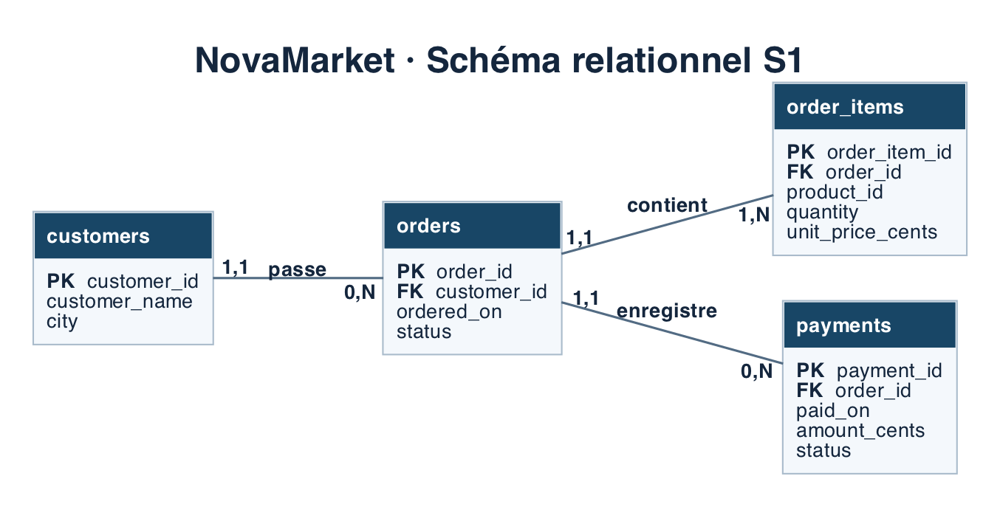

# Schéma relationnel NovaMarket S1

## Relations et cardinalités

**Légende** — `0,N` signifie zéro à plusieurs, `1,N` signifie un à plusieurs et `1,1` signifie exactement un. `PK` désigne une clé primaire et `FK` une clé étrangère.

- Un client peut passer zéro à plusieurs commandes. Chaque commande appartient à un seul client.
- Une commande intégrée contient une à plusieurs lignes d’articles. Chaque ligne appartient à une seule commande.
- Une commande peut avoir zéro à plusieurs opérations de paiement, par exemple si elle vient d’être saisie. Chaque opération concerne une seule commande.

## Grain et contraintes

Les clés primaires reprennent les identifiants des sources. Les colonnes des quatre tables métier sont obligatoires (`NOT NULL`). Les identifiants, la quantité et les montants sont de type `integer`. Les montants sont stockés en centimes d’euro. `ordered_on` et `paid_on` sont de type `date`. Le nom, la ville et les statuts sont de type `text`.

| Table et source | Grain | Contraintes métier et références |
| --- | --- | --- |
| `customers` · `customers.csv` | Une fiche client | `customer_id` est la clé primaire. |
| `orders` · `orders.csv` | Une commande | `order_id` est la clé primaire. `customer_id` référence `customers.customer_id`. `status` est parmi `completed`, `pending`, `cancelled`. |
| `order_items` · `order_items.csv` | Une ligne d’article dans une commande | `order_item_id` est la clé primaire. `order_id` référence `orders.order_id`. `CHECK (quantity > 0)` et `CHECK (unit_price_cents >= 0)`. `product_id` conserve le code source. Le catalogue est hors du périmètre S1. |
| `payments` · `payments.ndjson` | Une opération de paiement | `payment_id` est la clé primaire. `order_id` référence `orders.order_id`. `status` est parmi `captured`, `pending`. |

Les clés étrangères garantissent que chaque ligne d’article a une commande. Pour vérifier la cardinalité dans l’autre sens, le chargement vérifiera avant validation qu’aucune commande intégrée ne reste sans ligne d’article.

## Réception, rejets et intégration

1. Charger les quatre fichiers dans des tables de réception, avant d’appliquer les contraintes métier. Charger chaque ligne NDJSON comme un document `jsonb`, puis extraire les champs du paiement.
2. Contrôler les identifiants et les références. Conserver dans le journal des rejets la source, l’identifiant, les données de la ligne et le motif. Pour les données fournies, garder une occurrence de la ligne d’article `7` et rejeter l’autre comme doublon exact. Rejeter la ligne `801`, qui référence la commande absente `9999`.
3. Intégrer les clients, puis les commandes, puis les lignes d’articles et les paiements. Vérifier les références, la présence d’au moins une ligne d’article par commande et l’égalité entre le volume brut et la somme des volumes intégrés et rejetés.

## Choix de conception

1. Exiger une quantité strictement positive. Une ligne d’article décrit au moins une unité commandée. Le contrôle par commande complète cette contrainte en couvrant le cas où aucune ligne n’est présente.
2. Accepter un prix unitaire nul. Un article offert peut figurer dans une commande avec un prix de zéro centime. Le prix reste celui de la transaction.

[Dictionnaire des sources](../SOURCES.md)
